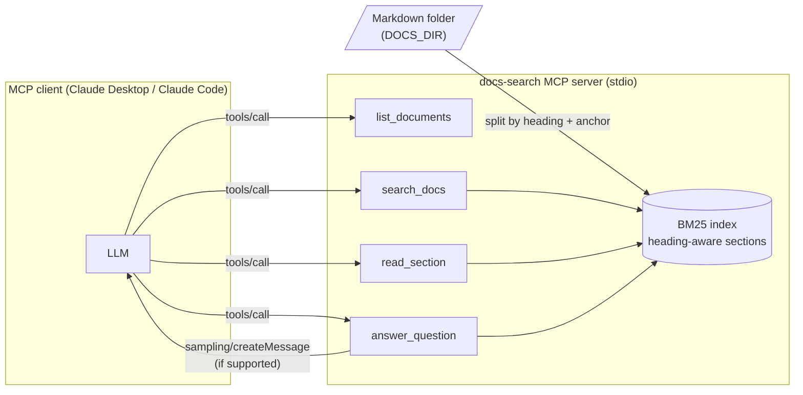

# mcp-server-example

A small, production-shaped [Model Context Protocol](https://modelcontextprotocol.io) server in TypeScript that lets an
AI assistant (Claude Desktop, Claude Code, or any MCP client) **search and read a local folder of Markdown
documentation** and **answer questions from it with citations**.

It ships with a sample corpus of 14 pages from the [FastAPI tutorial](https://fastapi.tiangolo.com/tutorial/)
(MIT-licensed, see `corpus/fastapi/LICENSE`), but works on any directory of `.md` files.

## Problem

LLM assistants hallucinate APIs when they answer from memory. Giving them a narrow, auditable tool to look up the
exact section of the docs — and making them cite it — is the cheapest way to ground answers. This repo shows how to
build that tool cleanly with the official [`@modelcontextprotocol/sdk`](https://www.npmjs.com/package/@modelcontextprotocol/sdk)
(v1.32), with typed inputs and outputs validated by [zod](https://zod.dev).

## Tools

| Tool | Input (zod-validated) | Output |
|---|---|---|
| `list_documents` | — | every indexed file with its title and section count |
| `search_docs` | `query` (1–500 chars), `limit` (1–20, default 5) | ranked sections with id, heading path, BM25 score and snippet |
| `read_section` | `id` such as `fastapi/query-params.md#defaults` | full section text |
| `answer_question` | `question`, `k` (1–8, default 4) | RAG: retrieves top-k sections and, if the client supports [MCP sampling](https://modelcontextprotocol.io/specification/2025-06-18/client/sampling), asks the client's model to answer with `[n]` citations; otherwise returns the numbered, citation-ready context |

All tools declare an `outputSchema` and return `structuredContent`, and are annotated `readOnlyHint: true`.

## Architecture



* `src/corpus.ts` splits Markdown into sections on headings (ignoring `#` inside fenced code), keeps explicit
  `{ #anchor }` ids and the full heading path.
* `src/bm25.ts` is a dependency-free BM25 (k1 = 1.2, b = 0.75) with heading terms boosted.
* `src/server.ts` registers the four tools with `McpServer.registerTool` and zod schemas.
* `src/index.ts` wires the server to `StdioServerTransport`.

## Run it

Requires Node.js ≥ 22.12.

```bash
npm install
npm run build
node dist/index.js                 # serves ./corpus
node dist/index.js /path/to/docs   # or DOCS_DIR=/path/to/docs node dist/index.js
```

### Claude Code

```bash
claude mcp add docs-search -- node /absolute/path/to/mcp-server-example/dist/index.js /absolute/path/to/docs
```

### Claude Desktop

Add to `claude_desktop_config.json` (see [`examples/claude_desktop_config.json`](examples/claude_desktop_config.json)):

```json
{
  "mcpServers": {
    "docs-search": {
      "command": "node",
      "args": ["/absolute/path/to/mcp-server-example/dist/index.js"],
      "env": { "DOCS_DIR": "/absolute/path/to/your/markdown/docs" }
    }
  }
}
```

### Try it without an LLM

```bash
npx @modelcontextprotocol/inspector node dist/index.js
```

## Tests

```bash
npm run typecheck
npm test
```

The suite (vitest) covers Markdown splitting, BM25 ranking, and the full MCP round trip through the SDK's
`InMemoryTransport`: tool listing, zod rejection of invalid input, unknown section ids, the context-only RAG path
and the sampling path with a stub client model. GitHub Actions runs typecheck, tests and build on Node 22 and 24.

## Results

Measured on Windows 11, Node 24.22, against the bundled 14-page corpus:

| Check | Result |
|---|---|
| Corpus indexed at startup | 14 documents, 182 sections |
| Test suite | 18 tests passed (3 files) |
| stdio smoke test (`initialize` → `tools/call search_docs` "background tasks after returning a response") | top hit `fastapi/background-tasks.md#background-tasks` |

Retrieval quality is not benchmarked here; the companion repo
[hybrid-rag-demo](https://github.com/erickmacielsoto/hybrid-rag-demo) measures BM25 against dense, hybrid and
reranked retrieval on a hand-labeled question set.

## Limitations

* Lexical retrieval only (BM25): paraphrased questions with no shared vocabulary can miss. See hybrid-rag-demo for
  dense + reranked retrieval.
* The index is built in memory at startup; there is no file watching or persistence. Fine for thousands of
  sections, not for millions.
* `answer_question` only generates text when the client implements sampling; many clients do not, so the tool
  falls back to returning grounded context for the calling model to use.
* FastAPI doc pages contain `{* ... *}` include directives for code samples that are not bundled, so code
  examples are missing from the sample corpus.

## License

MIT — see [LICENSE](LICENSE). The sample corpus in `corpus/fastapi` is © Sebastián Ramírez, MIT-licensed.
